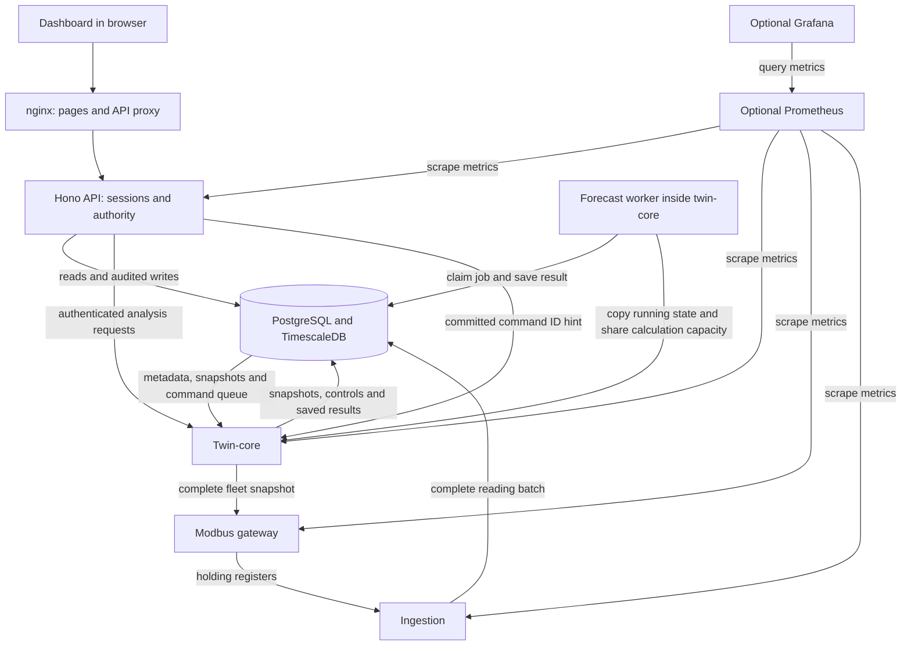
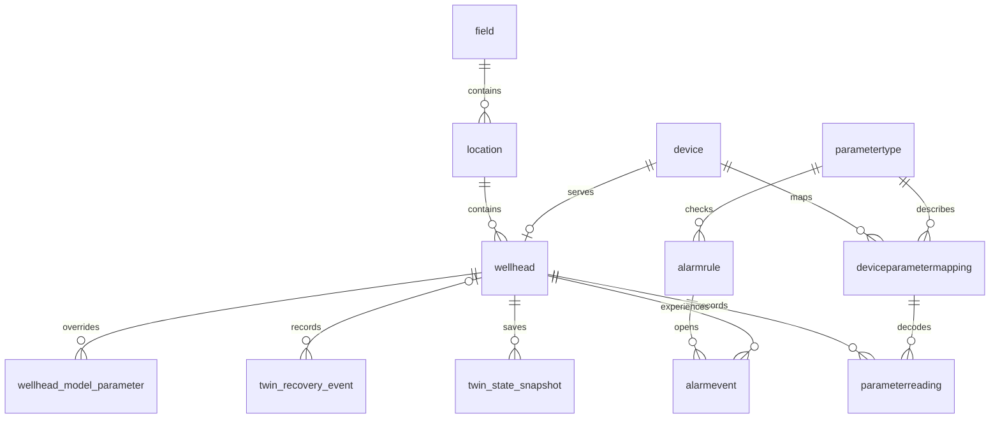
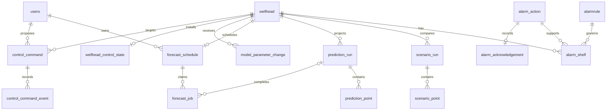

# Architecture Overview

## Current System

The [operating workspace](../design/operating-workspace.md) adds separate control
and parameter screens to the well view. The API keeps current-user authority,
revision checks and atomic audit records. Python supplies parameter metadata.
Proposal history supports recovery after a missing write response.

The current system is a simulated industrial monitoring pipeline:

```text
Twin-core model
  -> read-only fleet snapshot
  -> Modbus TCP gateway
  -> Database ingestion service
  -> PostgreSQL/TimescaleDB historian
  -> SQL alarm rules and analytics views
  -> TypeScript API and React dashboard
```

Twin-core reads active assets and calculates a deterministic process state for
each well on a fixed one-second step. The gateway reads one complete fleet
snapshot and serves all 18 seeded model signals as Modbus registers.
Ingestion polls the gateway and stores source-labelled readings. The seven
diagnostic signals added in model version 0.3.0 remain synthetic estimates.
Twin-core also saves model state in TimescaleDB and restores compatible state
after a restart. Recovery decisions and wall-clock jumps are recorded there.

The [Milestone 4 design](../design/twin-core-milestone-4.md) explains the
service boundary and data quality rules. The [Milestone 5 design](../design/twin-core-milestone-5.md)
explains the original process equations, units, and limits. The
[reference-well design](../design/reference-well-physics.md) explains the
additional phase and diagnostic equations. The
[Milestone 6 design](../design/twin-core-milestone-6.md) describes the Modbus
mapping and freshness rules. The [Milestone 7 design](../design/twin-core-milestone-7.md)
describes snapshots, parameter overrides, and restart recovery. The
[Milestone 8 design](../design/twin-core-milestone-8.md) describes saved forecasts
and isolated scenarios. The [8B design](../design/twin-core-milestone-8b.md)
describes live synthetic controls and parameter publication.
The [Milestone 9 design](../design/twin-core-milestone-9.md) connects those services
to the browser workspace.
The [usability design](../design/dashboard-usability.md) records the Guide,
contextual explanations and consistent page states. Saved results retain
their original inputs independently of the current draft.

## Current Dashboard Layer

The browser reaches the API through the dashboard's nginx proxy. It refreshes
the API address using Docker DNS, so container replacement needs no proxy reload.
Dashboard readiness checks both the page and /api/ready, including the API's
database dependency. Telemetry freshness remains a separate data-level check.

The dashboard exposes monitoring and model analysis:

- fleet-level overview for all simulated wellheads
- latest recorded telemetry snapshots, which may be partial after a read failure
- active alarms from database alarm evaluation
- analytics charts for pressure, temperature, flow, water cut, and GOR
- per-wellhead detail pages with current readings, alarms, and trends
- an Alarm Center with separate condition, acknowledgement and timed-shelf state
- per-well model status, successful process time, recovery details, and installed controls
- explicit forecast and scenario submissions with saved baseline comparisons
- canonical signal units, heuristic confidence reasons, and sampled threshold results
- bounded saved-run history and direct result URLs

React Router loaders read data and form actions create projections. Status polls
preserve draft inputs and do not repeat model submissions or reload saved points.
The internal model-status read is protected by the service token. The public API
returns only the status fields the dashboard needs, without model state or secrets.
If this optional read fails, the historian view remains available.

Monitoring shows installed controls as read-only values. OPERATIONS users open
the separate Controls screen to draft, review and activate a command. ADMIN
users open Parameters to publish an override that requires restart. Scenario
forms use private model copies. Saved results retain their original inputs,
so editing a new draft cannot change an older chart.

The operating and historical-scenario screens reuse existing tables. Scheduled
forecasts and alarm lifecycle actions add ordinary tables through the verified
schema extension. Every definition remains in `data/sql/schema.sql`.

Ingestion rejects a failed or mixed-time Modbus poll before inserting a batch.
The API can still show partial or stale latest views during source failure,
metadata changes, or while older readings expire.

## Lightweight Digital Twin

The running architecture puts twin-core between asset metadata and telemetry
output. It also serves bounded forecasts and isolated scenarios on request:

```text
Asset metadata
  -> Twin model registry
  -> Stateful wellhead process model
  -> Simulated telemetry
  -> Historian
  -> Twin-core forecast and scenario runner
  -> Authenticated API
  -> Operational dashboard
```

## Runtime Components

- **Twin core**: maintains current process state for each wellhead.
- **Process model**: updates pressure, flow, temperature, valve state, pump state, and degradation over time.
- **Telemetry adapter**: converts supported model fields into Modbus-readable register values.
- **Historian**: stores source-labelled readings, alarm events, model state
  snapshots, recovery events, and saved forecast and scenario runs.
- **Forecast and scenario API**: copies current model state, advances the same
  one-second model privately, and saves complete runs. It never applies a live
  control command. See [Milestone 8](../design/twin-core-milestone-8.md).
- **Dashboard**: shows current state, historical trends, alarms, model status,
  saved forecasts, and scenario comparisons. It keeps installed controls and
  scenario inputs in separate views.
- **Live control API**: saves an operator draft and explicit activation. Twin-core
  checks current authority and applies the durable targets before a model tick.
  Active control rows take precedence over older snapshots during recovery.
- **Parameter publication API**: validates administrator proposals through the
  Python resolver and writes an attributed override. A restart loads it into
  the running model.

## Implemented model and future measured-data work

Monitoring, the stateful process model, forecasts and private scenarios are
implemented. They all use the synthetic reference well. Forecast confidence is
a heuristic assessment of model limits, not a measured accuracy probability.

Measured telemetry comparison and divergence detection remain future work.
They need field measurements, calibration and a validation plan before the
system can compare a physical well with its model. Their absence does not block
the current synthetic workflows.

## Key Boundary

The project should not claim to be a high-fidelity reservoir simulator. The target is a **lightweight operational digital twin**: useful for demonstrating state, causality, prediction, alarms, and decision support.

## Diagrams

### Running services and write paths



The database also evaluates alarm conditions when ingestion inserts readings.
Alarm operator actions use the API transaction path. They do not change the
condition evaluator or send a control command. The forecast worker is a thread
inside twin-core, not a separate Compose service.

### Selected database relationships

These diagrams show the main stored relationships. The canonical SQL defines
all columns, constraints and deletion rules. Unquoted SQL names appear below in
their lowercase PostgreSQL form.





An acknowledgement uses the event ID and exact trigger time, but has no foreign
key to `alarmevent`. That lets event retention remove old chunks while the action
receipt remains. A shelf belongs to a well/rule pair and can outlive one active
event. A completed forecast job references its saved prediction run; other job
outcomes have no result. Scenario starting-state identity lives in the saved
JSON rather than a foreign key that would block snapshot retention.

### Historical diagrams

- [Original data model](../relevant_visuals/data-model.pdf): early metadata and historian sketch.
- [Original flow diagram](../relevant_visuals/flow-diagram.pdf): the older random simulator path.

These PDFs predate the current schema. The complete definition in `data/sql/schema.sql` is
canonical where the two disagree. The [schema design](../design/consolidated-schema.md)
explains installation, structural checks, and adoption of existing data.
Compose and CI pin PostgreSQL 16.15 with TimescaleDB 2.30.2. The
[engine upgrade design](../design/database-engine-upgrade.md) covers converting
an existing volume, verifying recovery, and accepting the new generated reference.

## Historical scenario source

A scenario can copy an exact retained model snapshot. The model service validates
the saved timestamp, physical state, version and parameter fingerprint before
running private baseline and scenario copies. The saved run carries its source
identity and complete inputs. Historical scenarios use alarm rules active at
execution; chart retention follows simulated dates. Forecasts continue from
current state. See [historical scenarios](../design/historical-scenarios.md).

## Scheduled forecasts

The Forecast page also shows an optional administrator-owned schedule. A separate
model-service worker claims bounded jobs from PostgreSQL, copies current running
state and calculates with the same model as manual forecasts. It checks owner
authority and claim expiry before atomically saving the result and completion.
The page distinguishes the latest attempt from the latest successful result and
shows each timestamp. No job writes live controls. See [scheduled forecasts](../design/scheduled-forecasts.md).

## Optional service metrics

The `observability` Compose profile collects the API, model, gateway and ingestion
metrics every 15 seconds. Prometheus stores up to seven days of metrics, subject
to a 512MB block retention cap. Grafana provisions the Service health dashboard
from the repository. Separate rows show endpoint reachability and service
readiness; absent or stale samples remain unknown. Both host ports bind to
loopback, and Grafana uses a separate local account. The dashboard proxy also
exposes the API metrics at `/api/metrics` without login. These tools cannot write
to the historian, model controls or alarm lifecycle. See the
[design](../design/observability.md) and [runbook](../../observability/README.md).

## Alarm operator actions

The SQL evaluator owns condition truth in `alarmevent`. The API stores an exact
event acknowledgement or a well/rule shelf in separate ordinary tables. One
transaction rechecks OPERATIONS authority, records the action receipt, changes
lifecycle state and writes the audit event. A unique actor/request key makes
explicit retries return the same result. Shelf revisions reject competing edits.

The Alarm Center separates Needs acknowledgement, All active, Shelved rules and
retained History. Active totals include acknowledged and shelved conditions. A
shelf expires by database time and still applies if the condition clears and
retriggers before its deadline. Event IDs stay decimal strings; exact UTC
timestamps retain their microseconds. The application role cannot alter alarm
events or existing receipts. See the [alarm design](../design/alarm-lifecycle.md).
