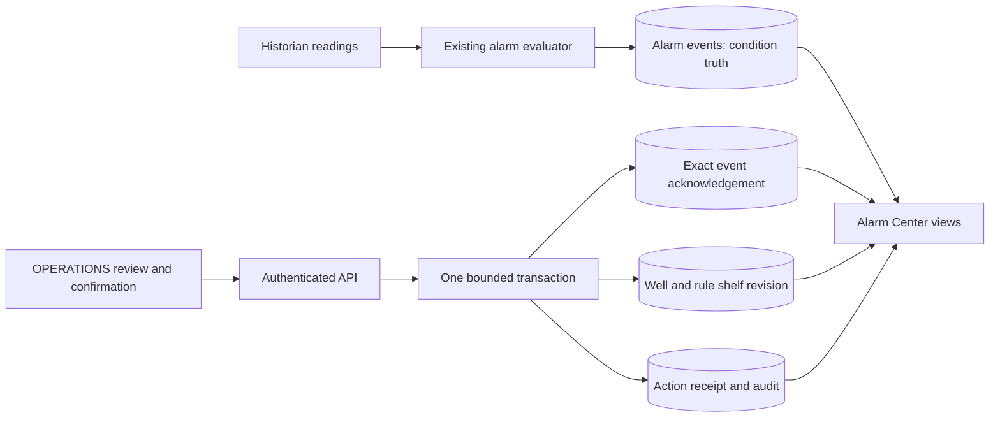

# Alarm acknowledgement and timed shelving

Date: 2026-10-17
Status: Implemented and verified locally
Decision: [ADR 0039](../adr/0039-alarm-operator-actions.md)

## Scope and system design

Extend the Alarm Center with acknowledgement, timed shelving, early unshelving,
operator reasons and action history. Preserve the current SQL evaluator, its
three-breach/three-clear seeded behavior, threshold definitions and active totals.
The lifecycle changes no reading, rule, model control or physical equipment.

## State and logic

Use three independent states:

- Condition: active when `alarmEvent.cleared_at IS NULL`, otherwise returned to normal.
- Acknowledgement: present only for that event's exact bigint ID and trigger time.
- Shelf: active when `shelved_until > observed_at`, where `observed_at` is the
  database time for the read. Equality means expired.

`needsAcknowledgement = !acknowledged && !shelved`. It includes retained events
that cleared before acknowledgement. `activeTotal` depends only on condition
state. Retriggering creates a new event that needs its own acknowledgement;
a well/rule shelf still applies until its deadline. Expiry needs no background job.

Events currently have 90-day retention. The list covers retained rows and does
not imply a permanent event archive. General audit events also have 90-day
retention. New receipts and acknowledgement metadata remain durable; they contain
only action context, not copies of telemetry histories. Their future archival
policy must preserve receipt and current-state references.

## Persistence and exact identity

Append three ordinary tables to `data/sql/schema.sql` and regenerate its catalog
contract from a fresh database. Use the existing verified `extend` command with
copies of the immediately preceding source and contract. Test a restored backup
before extending the main database. Do not create numbered migration files.

| Table | Identity | Stored meaning |
| --- | --- | --- |
| `alarm_action` | UUID, unique actor/request key | Immutable input hash, input, actor name/ID, timestamp and confirmed result |
| `alarm_acknowledgement` | Event bigint and exact trigger time | Acknowledged time and receipt ID |
| `alarm_shelf` | Well and rule | Latest deadline, revision, updated time and receipt ID |

Acknowledgement and receipt records deliberately have no foreign key to the alarm
hypertable. Shelves reference existing wells/rules. Current state references its
immutable action receipt. The application role can read/insert receipts and
acknowledgements, but cannot update/delete them. Shelf updates have narrow grants.
It receives no new UPDATE grant on alarm events, rules or wells.

Extract the existing bigint/UTC-microsecond validators into a shared identity
module and preserve the snapshot exports as aliases. New alarm responses encode
IDs as decimal strings and UTC timestamps with six fractional digits. SQL casts
and `to_char` preserve identity before the driver can round it. Format times for
people only after storing the original strings used for requests.

## API and transaction boundary

All reads require `dashboard:read`. Writes require `alarm:acknowledge`, a maximum
4KB JSON body and the existing ten-per-user-per-minute command budget.

- `GET /alarms`: summary totals plus 50 event rows, filter `attention`, `active`
  or `history`, optional well ID and bounded cursor. Attention/active order by
  severity, then oldest trigger time and exact ID; history uses newest time/ID.
- `GET /alarms/shelves`: current shelves, 50 per page, with well/rule cursor.
  It includes shelves whose condition has returned to normal.
- `GET /alarms/events/:eventId?triggeredAt=...`: current exact event, its current
  shelf and the latest 20 actions for that well/rule. A retained event may clear
  without losing its acknowledgement. Missing/expired identity returns 404.
- `POST /alarms/actions`: one strict acknowledgement/shelve/unshelve input,
  explicit confirmation, reason (1–500 characters) and UUID Idempotency-Key.
- `GET /alarms/actions/:requestKey`: the signed-in actor's committed receipt,
  or 404. Never expose another actor's request key lookup.

Both list responses also carry the reference fleet’s well names for the filter
and compute their summary within the same read transaction.

Each write starts with a 500ms lock timeout and 3s statement timeout. Lock/recheck
the current user first, using the existing transaction authority helper. Check
for an existing own receipt; matching input returns the original result, and a
different input returns 409. An acknowledgement requires an existing retained
exact event and fails with 409 if another action already acknowledged it. It can
acknowledge an active or returned-to-normal event.

Shelf writes require the last observed revision (zero if absent). Lock an existing
shelf row, validate the expected revision, then calculate the new deadline from
the database clock after acquiring locks. The initial insert's unique key closes
the absent-row race. Unshelving requires an unexpired shelf. A changed revision
or expiry returns 409 and requires another read/review. Replace a shelf only with
a new explicit action and reason; there is no silent renewal.

Insert the immutable receipt, mutate lifecycle state and insert the audit event
in the same transaction. An exception rolls back all three. Log the request ID
and error code without input reasons or credentials. Database/transport failure
returns 503 with an uncertain outcome: the browser must look up the same key.
A retry must preserve that key and exact reviewed input. No automatic write retry.

Read the summary and list within one read-only repeatable-read transaction so
counts and rows share a snapshot and database observation time. Cursor pages are
live views; new state may move a row between views. Use First page to return to the current start of the list. Refresh updates
the page being read. Keep at most one page in the browser, with Next and First page controls.
Never infer totals from the visible page.

## Screen design and copy

The Alarm Center opens at **Needs acknowledgement**. Keep four summary tiles:
all active, active critical, needs acknowledgement and current shelves. Explain
that active includes acknowledged and shelved conditions. Tabs expose Needs
acknowledgement, All active, Shelved rules and History. A well filter narrows each
view. History shows retained events and their process/acknowledgement states.

Use readable cards with well, severity, parameter, trigger value and threshold,
condition status, acknowledgement and shelving state. Label the threshold as
**Current rule threshold**: the event stores its trigger value and severity, but
not a historical copy of the rule threshold. Show the rule’s current breach/clear
counts instead of assuming every rule always uses the seeded count of three. Put timestamps and actor
reasons in expandable details. Show the event's precise identity only in those
details. Open well remains a normal link. An explicit Review action opens one
editor with its target, action, reason, duration when relevant and confirmation.
The default shelf duration is 30 minutes; accept 5–480 whole minutes. Label the
final buttons Acknowledge event, Shelve rule or End shelf now.

A reader sees the same evidence and the explanation that OPERATIONS performs
these actions. ADMIN also gets that explanation. Never show a working write form
based only on a stale role: the server rechecks authority at the transaction.

Retain the last successful read with its timestamp on refresh failure. Disable
write forms after a failed read or after 20 seconds without a successful refresh.
Keep typed reasons during background refresh. A revision change requires explicit
review of the new state; do not adopt it silently. A lost write reply freezes the
reviewed input and offers Check result. A confirmed receipt closes the editor,
announces the result, refreshes the list and moves focus to the outcome message.
A conflict keeps the reason but requires a fresh target review. Permission loss
clears the operating view through the existing route error boundary.

Use the shared spacing, typography, blue actions and named severity badges.
Cards stack at 320px; labels wrap and interactive targets retain 44px height.
Native details elements provide keyboard-accessible extra context. A short help
section explains that acknowledgement records recognition, normal readings clear
the condition, and shelving temporarily removes a rule from the attention view.
Shelved rules remain visible in their own list and in all-active totals.

## Design checks before implementation

Check 1 traced evaluator SQL, event retention, exact snapshot identity handling,
capability separation, audit grants, account-first locking, retained-read behavior
and command rate limits. It found two necessary additions: retain cleared but
unacknowledged events in the attention view, and list shelves independently of
active events. Reusing rounded legacy overview IDs for writes is excluded.

Check 2 passed 84 screen/state/role/viewport combinations at 1440, 390 and 320px,
with no horizontal overflow or browser errors. It included a shelf without an
active event, disabled write controls, explicit uncertainty recovery and role
restrictions. Sixteen condition/acknowledgement/deadline cases passed, including
exact expiry and returned-to-normal events. The identity check demonstrated why
a bigint above JavaScript's safe range must stay a string.

The concurrency review confirmed account-first locking, a unique insert for the
absent-shelf race, revision checks after row locks and one transaction for receipt,
state and audit. It also required current-threshold wording because the original
threshold is not stored in the event. The first prototype assertion checked the
fieldset rather than its disabled controls; that harness check was corrected.
The prototype now preserves its event handlers when adding the help section.

## Verification plan

Test exact bigint/microsecond identity, role separation, current session revocation,
input limits, CSRF, idempotent replay/payload conflict, competing acknowledgement,
shelf revision races, expiry and retrigger behavior. Inject audit failure and prove
all lifecycle writes roll back. Use the actual restricted API role and verify its
immutable-table grants. Test paging, summary consistency and action history.

Verify the schema on a fresh database and on a restored copy of the current main
database, comparing existing record counts/fingerprints. Extend the isolated
installation, then test real browser actions, failure recovery, stale drafts,
permission loss, phone layout and accessibility. Review and fix findings before
main extension, local deployment and commit. Keep the physical sleep/wake and
remote publication gates separate from these local results.

## Review finding: restored forecast checks, 2026-10-17

The first full restore reached the structural gate and stopped before extension.
The main database matched its old contract. A temporary-table reproduction found
four forecast duration checks with different parentheses: PostgreSQL expands
`BETWEEN` into a nested `AND` during initial creation, then flattens the `AND`
when parsing the expression written by `pg_dump`. Both retain the same bounds
and whole-minute divisibility test.

The first review compared the original and restored definitions on the pinned
engine and confirmed validation flags. The second limited the remedy to an
exact whole-expression match for `interval_seconds` and `horizon_seconds`, with
numeric bounds, modulo and equality. It preserves every operand and rejects
other shapes. Unit tests must still detect changed bounds, divisors, remainders,
operators, columns and validation flags; a database test covers the actual
round trip and all 27 true/false/null combinations for AND associativity.
The canonical SQL and its recorded checksum remain unchanged by this fix.

The browser review also exposed unstable implicit label lookup after a textarea
or select rerender. The editor and well filter now use explicit labels, and the
duration explanation uses `aria-describedby`. Closing a review returns focus to
its originating button; each receipt has its own identity so repeated actions
still move focus to their confirmation.

Rendered inspection caught a missing shared form class that automated interaction
checks did not flag. The editor now uses the established form styles, explicit
labels and a three-line reason field. Summary tiles stack below the small-screen
breakpoint to avoid splitting long labels. The browser regression also checks
that the action, reason and well controls keep a 44px minimum height.

The parallel full-restore attempt failed while loading TimescaleDB catalog
foreign keys. It affected only its disposable database. The full rehearsal uses
serial `pg_restore`, as required by the [official restore guide](https://github.com/timescale/Tiger-Data-Docs/blob/main/src/content/docs/deploy/self-hosted/backup-and-restore/logical-backup.mdx).
Do not add `-j` or `--jobs` to this full-database restore procedure.

Rendered implementation examples use an explicit synthetic browser-test fixture:
[desktop review](../screenshots/alarm-review-desktop.png) and
[phone review](../screenshots/alarm-review-mobile.png).

## Verification on 2026-10-17

- Both design checks passed before implementation: 84 rendered combinations and
  16 state cases, followed by the documented concurrency and identity review.
- All 127 API integration tests passed against the restricted application role.
  The 17 new lifecycle cases cover exact identities, retained cleared events,
  role/session checks, idempotency, concurrent acknowledgement and shelf edits,
  expiry/retrigger behavior, pagination and audit rollback for inserts and updates.
  The original alarm-count and analytics regression tests remain in the suite.
- The shared-contract and frontend suites passed 40 tests. The schema unit and
  comparison suites passed 60 tests. Forty-one database lifecycle cases passed;
  the new parser round-trip case passed separately after correcting its fixture
  to use the provided connection. No database cases were skipped.
- The alarm and general usability browser workflows passed. Fault injection
  covered retained drafts, explicit current-state review, lost replies, same-key
  retries and permission loss. The alarm workflow checked keyboard focus, 44px
  controls and layouts at 1440, 390 and 320px, with no horizontal overflow or
  unexpected browser errors. Automated WCAG 2 A/AA, 2.1 AA and 2.2 AA checks
  reported no violations. This is not a claim of full assistive-technology coverage.
- A real isolated OPERATIONS session acknowledged an exact bigint/microsecond
  event without clearing it. A deliberately lost committed reply resolved by
  receipt lookup without another POST. A shelf survived clear/retrigger and ended
  early, producing three receipts while all installed controls stayed unchanged.
- The serial full-backup restore and alarm extension preserved counts and
  fingerprints for 3,657,848 records across 26 existing tables. The private
  archive is 86,552,890 bytes. The disposable restore database and temporary
  container copy were removed; the original private archive remains.
- Type checks, lint, formatting, OpenAPI validation and prose checks passed.
  Initial failures included an undeclared build dependency, a timestamp-expression
  precedence error, test fixture errors, implicit labels and a missing form style.
  Review fixed those findings. The first concurrent API run timed out under
  restore load; the complete rerun passed after that load ended.

Remote CI and publication have not run. Physical host sleep/wake remains deferred
by the owner. The reference model remains synthetic and has no field calibration.

The main database extension then passed without replaying seeds. The deployed
API and dashboard passed all four alarm views using the read-only demo account,
including phone layout and browser-error checks. All eight Compose services are
healthy, all four Prometheus targets are up, and the authenticated provisioned
Grafana dashboard remains available. The fingerprint of the installed control
state for all 12 wells is unchanged. Prior API/dashboard images remain tagged
`before-alarms` locally; the database extension only adds the lifecycle tables.
