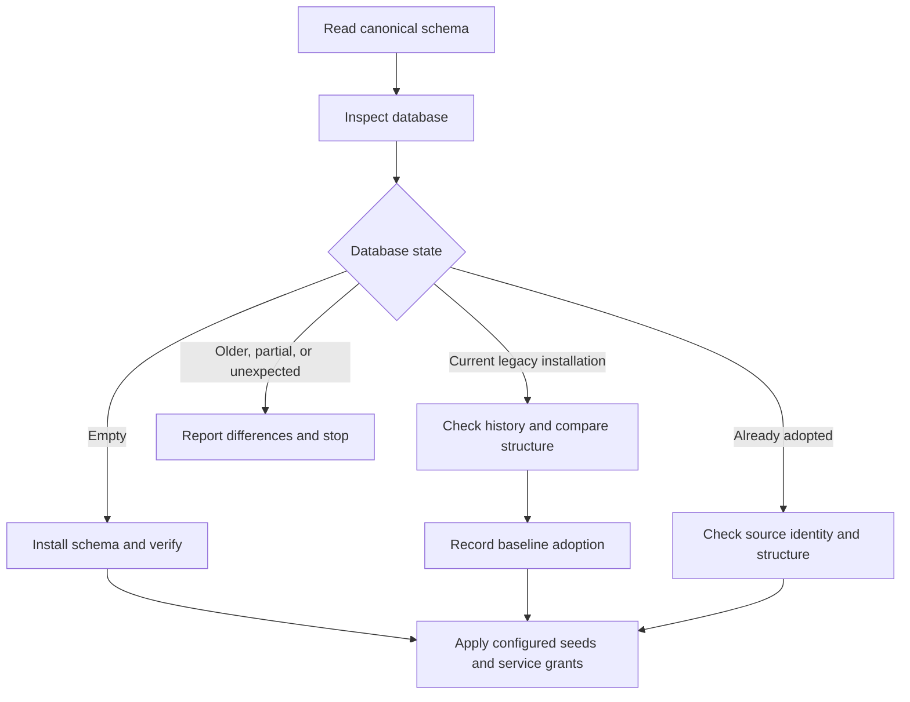

# One current database schema

Status: implemented and adopted on the local database, 2026-10-13.

The owner selected one SQL schema file on 2026-10-13. The maintained source will
be data/sql/schema.sql. The owner then authorized implementation.

## What this resolves

The owner asked on 2026-10-03 to combine the database definitions into one file
and asked whether the file must be SQL. The follow-up on 2026-10-05 asked for
more explanation. That discussion did not settle the implementation.

The intended result is one readable definition of the complete current schema.
The owner should not need to mentally replay a sequence of corrections to find
the current columns, constraints, or policies.

This implementation replaces the numbered schema files as the maintained source.
Git retains their history. A generated overview beside an unchanged migration
chain would not satisfy this request.

## What was checked

At commit ec85ac5, data/sql/migrations contains 13 SQL files and 928 lines.
The live database records all 13 with matching checksums. Its two seed files
bring the existing schema_migrations ledger to 15 records.

The database has 23 application tables, seven TimescaleDB hypertables, four
continuous aggregates, and two ordinary application views. A hypertable holds
time-series data in chunks. A continuous aggregate stores automatically
refreshed summaries. The installed TimescaleDB version is 2.19.3.

The former Python runner locked each applied file to its checksum. It could not
simply load a replacement file against the existing database. Some old scripts
also drop and recreate views. Replaying those scripts would be the wrong
operation for a database whose structure is already current.

## Format options

| Option | What the owner maintains | Benefit | Cost |
| --- | --- | --- | --- |
| One schema.sql file, chosen | The complete current SQL definitions | Uses the database's own language and preserves existing TimescaleDB definitions | SQL remains part of the project |
| One Python schema module | Python definitions plus SQL for database-specific features | Keeps the file in the service's language | Adds a representation to learn; function bodies and TimescaleDB calls still need SQL |
| One TypeScript schema module | Drizzle definitions plus database-specific SQL | Places definitions beside the API's typed access layer | Requires checking coverage for domains, triggers, functions, aggregates, and policies |
| Desired-state comparison tool | One schema plus tool configuration | Can inspect an existing database and propose changes | Must first prove coverage for every TimescaleDB object this project uses |

The extension does not decide whether changes are safe. A Python or TypeScript
file can still contain a chain of historical changes. A SQL file can describe
the complete current state without such a chain.

Atlas documents a workflow that compares a desired schema with an existing
database and prepares changes. Its complete support for this project's
TimescaleDB objects has not been verified. It is therefore a separate option
to investigate, not a dependency of this implementation.
See [Atlas declarative apply](https://atlasgo.io/declarative/apply).

## Recommended layout

```text
data/sql/schema.sql            Complete current database structure
data/sql/schema-contract.json  Generated structure and legacy checksums
data/sql/seeds/                Demo records, separate from structure
data/src/schema.py             Command entry point and service provisioning
data/src/schema_install.py     Installation, adoption, history, and locking
data/src/schema_catalog.py     Database structure comparison
data/src/schema_sql.py         SQL loading and statement splitting
monorepo/packages/db/          Typed application access, checked against SQL
```

Schema means structure: tables, columns, rules, functions, and database policies.
Seed data means example records, such as the demo wells and reviewer account.
Keeping seeds separate lets a database install its structure without inventing
demo assets. Password generation and environment-specific grants remain in
Python, where the existing service provisioning already lives.

The schema file groups current definitions by purpose:

1. Extension, enums, and the model-version domain.
2. Accounts, assets, parameter metadata, readings, and alarms.
3. Twin snapshots, recovery records, parameter overrides, and projections.
4. Control commands, active controls, events, and parameter proposals.
5. Functions, triggers, indexes, and ordinary views.
6. Hypertables, continuous aggregates, refresh, compression, and retention.

The actual statement order must also respect dependencies. For example, a
hypertable must exist before its continuous aggregate or compression policy.

Fold session_version, reading source_kind, reading model_version, and alarm
counters into their final table definitions. Include active_controls_restored
in the original recovery-event constraint. Remove obsolete view drops and
superseded definitions from the new installation script.

Keep model_version_text as a domain. The existing compressed historian depends
on that choice, as explained in ADR 0036. This consolidation does not redesign
column types, public responses, model behavior, or service permissions.

## Installer logic

The command modes are init, check, adopt, and build-reference. The default is
init. It installs an empty application schema or checks an adopted database.
A legacy database needs an explicit adopt command. check never applies schema,
seed records, accounts, or grants.

build-reference requires an empty application schema and --contract-output.
It installs schema.sql and captures the actual catalog into a comparison record.
The record contains the SQL checksum, PostgreSQL major version, TimescaleDB
version, expected structure, and immutable legacy file checksums. It is generated,
not edited alongside the SQL. It contains no application rows or credentials.

Compose and CI pin the verified PostgreSQL 14 / TimescaleDB 2.19.3 image by digest.
The installer rejects other versions before a normal fresh installation.
Schema tests rebuild from the SQL and compare against the generated record.



### New database

Install the canonical file only after proving that application objects are
absent. Use a database advisory lock so two installers cannot run together.
An advisory lock is a named lock used by cooperating application processes.
Apply statements in dependency order, respecting operations that cannot share
a transaction, then verify the resulting structure before marking it ready.

The schema_installation table records the source and reference checksums, actor,
method, completed statement count, and start and completion times. A partial
installation remains incomplete and normal retries stop. It has no automatic
resume or cleanup command. Inspect progress before restoring a backup or
explicitly rebuilding an expendable database. A crash between a statement and
its progress update requires inspecting the database, not assuming the statement
failed.

### Existing database

Adopt a fully current legacy installation without replaying its schema SQL:

1. Take a backup and verify the backup procedure on a disposable database.
2. Verify every expected legacy filename and checksum. Reject an incomplete,
   modified, or unknown history.
3. Compare the actual application structure with the generated reference from
   a fresh installation on the supported PostgreSQL and TimescaleDB versions.
4. Check service privileges separately using the configured role names. The CLI
   reprovisions those grants transactionally after schema verification.
5. Record the canonical source checksum and verified baseline identity in a
   transaction. Keep the old schema_migrations records unchanged as history.
6. Run the application checks and confirm existing readings and controls remain.

Reference generation is a release operation on a disposable database. Ordinary
startup compares catalog definitions with that record and does not require
CREATEDB privileges or another database.

A checksum proves which file was used. It does not prove the actual database
still matches that file. The structural comparison must include column types,
defaults, nullability, keys, constraints, indexes, functions, triggers, views,
hypertable dimensions, aggregate definitions, compression settings, and policies.

Exclude data values and generated identifiers from that comparison. Internal
chunk IDs and job IDs can differ between equivalent installations. Match those
objects by their application meaning, such as the hypertable or aggregate name.
Tests alter the dimension interval, compression order, aggregate mode, and job
schedule to prove those differences remain visible. Generic catalog checks also
cover enum and domain rules, sequence definitions, row security, and public
function execution privileges. Service-specific grants remain a separate check.

### Ordinary restart

Check the recorded canonical identity and required structure. An unchanged
database needs no schema operations. Seed and account setup keep their existing
separate rules. Schema mismatch must produce an actionable error before dependent
services start, without deleting or recreating application objects.

## What happens when the schema changes later

One source file removes the need to reconstruct the current design from old
patches. It does not remove the work of converting an existing database.

For example, changing a column name in a definition does not tell a tool whether
to preserve old values under a new name or discard them. Renames, removals,
conversions, and changes to aggregates need a reviewed operation for existing data.

This implementation provides consolidation, fresh installation,
verification, and adoption. It does not include a general automatic schema-diff
engine. Editing schema.sql alone will not automatically upgrade an older database.
A later change must include an explicit, tested conversion plan when preserving
an existing database. The operational record must identify the before and after
schema and the operation that was applied. A disposable development database
can instead be rebuilt when its owner explicitly chooses to discard its data.

Do not silently reintroduce a numbered corrective-file chain as the default
authoring workflow. Keep the current schema authoritative and explain the
existing-data conversion alongside the feature that needs it.

CREATE TABLE IF NOT EXISTS only suppresses a name collision. PostgreSQL does
not guarantee that the existing table matches the requested definition.
See [PostgreSQL 14 CREATE TABLE](https://www.postgresql.org/docs/14/sql-createtable.html).

## Failure behavior

| Condition | Required result |
| --- | --- |
| Database unavailable | Fail startup with a safe connection error |
| Another installer holds the lock | Wait for a bounded interval, then report the conflict |
| Legacy checksum differs | Refuse adoption; show the filename without changing the database |
| Ledger matches but structure differs | Refuse adoption and report the actual structural difference |
| Installation stops partway | Keep incomplete status and inspect before retry |
| Existing schema differs from the new source | Require a reviewed conversion or explicit disposable rebuild |
| Aggregate or policy comparison is unsupported | Fail the check; do not treat an unchecked object as matching |
| An operation would remove data | Require a separate explicit decision showing what would be lost |

## Release verification order

1. Produce the consolidated current-state SQL and a section-by-section review.
2. Build a disposable database from it and compare it with the current schema.
3. Implement init, check, and adopt with locking, clear state, and failure handling.
4. Test adoption against a restored copy of the populated existing database.
5. Test changed checksums, structural drift, partial installation, concurrent
   installers, repeat startup, and mismatched TimescaleDB settings.
6. Update the Drizzle contract tests and API test harness to install the same
   canonical schema as Compose. Run the complete API and Python gates.
7. Verify alarms, telemetry, snapshots, projections, controls, account revocation,
   retention, and service grants after adoption. Compare records before and after.
8. Replace the old schema directory, update operational guides, and rebuild
   containers. Adopt the original local database only after the copy passes.

Schema consolidation does not require deleting the current Docker volume.
Deleting source files in a new commit preserves Git history; rewriting existing
commits is unnecessary. This design does not authorize a new commit or push.

## Verification record

The first disposable installation matched the live database's checked structure.
All 13 legacy checksums matched before adoption work began. The automated schema
suite covers fresh installation, repeat startup, adoption, incomplete history,
changed checksums, actual structural drift, concurrent installers, and an
interrupted installation. It is included in the database CI job.

Completed release checks:

- Schema suite: 59 passed, including 28 tests against disposable databases.
- Full Python suite: 234 passed, 41 skipped because they require database opt-ins.
  All 41 were run separately: 28 schema cases and 13 control/projection cases.
- API integration suite: 89 passed with the restricted API database role.
- Ruff lint and formatting, strict mypy, changed TypeScript formatting, prose,
  and Git whitespace checks passed. The installer container built successfully.
- Physical backup: pg_verifybackup passed. An isolated server recovered from a
  copy using the same database image.
- Recovered-copy adoption preserved counts and content fingerprints for all
  23 application tables, containing 9,308,932 rows, plus all 15 legacy ledger rows.
- Live adoption exited successfully. Application object identities, accounts,
  controls, legacy history, and historical reading samples stayed unchanged.
  No application table's row count fell during the check.
- Normal installer startup and the read-only check both exited successfully.
- All six long-lived services stayed healthy. Twin-core reported 12 running
  wells; ingestion reported 216 mappings. The API and dashboard returned HTTP 200.
- Fresh connections with the live API and twin credentials read current model
  telemetry. Checks confirmed their restricted grants and absence of schema
  creation and temporary-table privileges.
- Disposable test databases, roles, and the recovery server were removed.
  The verified physical backup remains available.

The first sandboxed Python run could not open local HTTP sockets; it passed
with local network access enabled. Test setup was corrected for masked connection
passwords and inherited TimescaleDB extensions. An extra test found generated
IDs in internal trigger definitions. The comparison now resolves those IDs to
table names and still rejects a trigger pointing at the wrong hypertable.

The verified physical backup is retained in Docker volume
well_schema_physical_backup_20261013. The original live volume was preserved.
No commit or push was made.

### Recovery finding: compressed null columns

A logical backup completed, but restoring it on TimescaleDB 2.19.3 failed in a
compressed chunk's model_version column. The error reported a null return while
reading the compressed value Bg==. This matches
[TimescaleDB issue 8893](https://github.com/timescale/timescaledb/issues/8893).
The maintainer identifies 2.20.0 as containing the fix. The failed logical
restore is not evidence of a recoverable backup.

For this release, use a physical backup of the database cluster. It preserves
the database files and the write-ahead log, which PostgreSQL uses for recovery.
pg_basebackup creates it while the server runs; pg_verifybackup checks its
manifest and required log records. Start a separate server from a copy of the
verified backup before adopting the live database. Keep the original backup
unchanged. See [pg_basebackup](https://www.postgresql.org/docs/14/app-pgbasebackup.html)
and [pg_verifybackup](https://www.postgresql.org/docs/14/app-pgverifybackup.html).

The local verification uses a dedicated Docker volume for the physical backup
and another for the recovered copy. The recovery server binds only to the host's
loopback interface. It runs the same image, with background jobs disabled during
record comparisons. No application service connects to that copy.

### Repeating the physical backup check

These commands use a new volume name and the running database's exact image.
The backup client shares its network namespace so the connection uses the
existing loopback replication rule. The selected environment value is the
username, not its password.

```sh
schema_backup_volume="well_schema_backup_$(date -u +%Y%m%dT%H%M%SZ)"
schema_recovery_volume="${schema_backup_volume}_check"
schema_db_image=$(docker inspect --format '{{.Image}}' wellhead_db)
schema_db_user=$(docker exec wellhead_db printenv POSTGRES_USER)

docker volume create "$schema_backup_volume"
docker run --rm --network container:wellhead_db \
  --mount "type=volume,source=$schema_backup_volume,target=/backup" \
  "$schema_db_image" pg_basebackup -h 127.0.0.1 -U "$schema_db_user" \
  -D /backup -X stream -c fast --manifest-checksums=SHA256

docker run --rm --network none \
  --mount "type=volume,source=$schema_backup_volume,target=/backup,readonly" \
  "$schema_db_image" pg_verifybackup /backup

docker volume create "$schema_recovery_volume"
docker run --rm --network none \
  --mount "type=volume,source=$schema_backup_volume,target=/backup,readonly" \
  --mount "type=volume,source=$schema_recovery_volume,target=/restore" \
  "$schema_db_image" sh -c 'cp -a /backup/. /restore/'
docker run -d --name "$schema_recovery_volume" -p 127.0.0.1:55440:5432 \
  --mount "type=volume,source=$schema_recovery_volume,target=/var/lib/postgresql/data" \
  "$schema_db_image" -c timescaledb.max_background_workers=0 -c autovacuum=off
```

Wait for the recovered server to accept connections. Use the configured database
credentials with host 127.0.0.1 and port 55440 to verify structure and stored
records on that copy. It has no application writers. Keep jobs disabled during
the before-and-after adoption comparison. For a recovered database that already
has the current baseline, run check instead of adopting again.

After verification, stop and remove that named recovery container and its copy
volume. Retain the verified backup volume separately. Do not start the backup
volume itself as a running server, because recovery and later writes change it.

A physical backup covers the whole PostgreSQL cluster, including its roles and
other databases. Protect it like the live volume. Its recovery requires matching
PostgreSQL and TimescaleDB binaries. A separately tested TimescaleDB upgrade is
needed before relying on logical restores of the affected compressed data.

## Related

- [ADR 0006](../adr/0006-schema-management.md): original schema ownership decision and the single-file amendment.
- [ADR 0036](../adr/0036-model-telemetry-through-modbus.md): reading source and model-version compatibility.
- [8B design](twin-core-milestone-8b.md): existing controls and privileges that consolidation must preserve.
