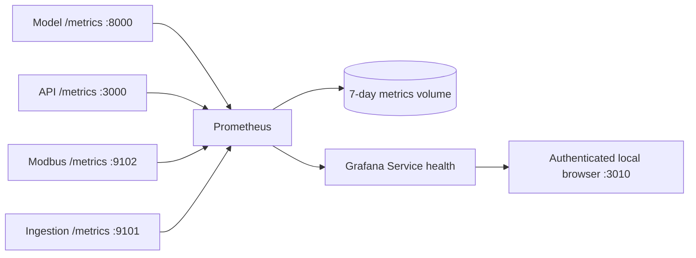

# Optional service metrics

Date: 2026-10-17
Status: Implemented and verified locally
Decision: [ADR 0029](../adr/0029-metrics-stack.md)

## Purpose and scope

Help a maintainer locate a stopped service, delayed historian write, model lag or
failed background job. Keep the plant dashboard focused on wells and analysis.
The optional `observability` Compose profile adds Prometheus and Grafana. The
normal stack starts without them or their credentials.

Prometheus collects the four existing service endpoints every 15 seconds, with a
5-second scrape timeout. Grafana reads Prometheus and presents the versioned
Service health dashboard. Neither component writes controls, parameters, alarm
state or historian readings. No database exporter or external notification service
is part of this addition.

The four Compose targets are `twin-core:8000`, `api:3000`, `modbus:9102` and
`ingestion:9101`. Prometheus is available only on host loopback port 9090;
Grafana uses loopback port 3010. Service metrics remain inside the Compose network.
Each optional service has its own named volume. Prometheus retains at most seven
days or 512MB of retained blocks, whichever limit applies first. Its WAL and
in-memory working data need additional capacity; the block cap is not a hard
container disk quota. Grafana keeps local accounts and preferences in its own
volume. Stopping the profile preserves both volumes.

## Images and credentials

Verified official images on 2026-10-17:

- Prometheus LTS 3.13.4, digest `sha256:87861b8cf91579109319ebc300f3f1060e6da9c05d6ae8ad15a20c879e84e32e`.
- Grafana OSS 13.2.4, digest `sha256:dbbc38ea21103cefb50396340cd88afec779c7e070b0a7bf5a75b4ce46651d3f`.

Pin both digests. The images run as their supplied non-root users. Drop Linux
capabilities and prevent privilege escalation. Mount configuration read-only and
keep writable state in named volumes. Health checks use the tools verified inside
the images; the Grafana image exposes `/run.sh`, `wget` and `grafana`.

Grafana uses a separate local administrator account, with its password in the
ignored `.env` file as `GRAFANA_ADMIN_PASSWORD`. Its startup wrapper refuses an
absent or short password before invoking `/run.sh`. An empty default during Compose
interpolation lets the ordinary stack work without optional credentials; starting
Grafana without a suitable value fails explicitly. Disable anonymous access,
self-registration, telemetry reporting, update checks and automatic installation
of suggested plugins. Use the built-in panels and light theme. Allow 180 seconds
for first-start storage initialization before counting failed health checks.

The password initializes a new Grafana database. Changing the environment value
later does not reset an existing account; document the explicit reset procedure.
Do not print the password in logs or commit it. The local setup may generate a
random value when no value exists, preserving any existing configured credential.
The Grafana account has no relationship to the well dashboard's roles.

## Readiness and time semantics

A successful scrape means the metrics endpoint answered. Readiness means a service
reported that it could do its work. The dashboard presents these as separate rows.
A failed or absent scrape never produces a green readiness value.

Reuse each service's existing readiness authority:

- Telemetry: expose `well_sim_telemetry_ready` from the current `ServiceHealth`
  object during `/metrics`. Do not keep another readiness state machine.
- Model: calculate its existing readiness when serving `/metrics`, so the model
  gauge reflects tick and fleet state at collection time. This calculation uses
  in-memory state and adds no database query.
- API: record `well_sim_api_database_ready` and
  `well_sim_api_readiness_checked_timestamp_seconds` when the existing `/ready`
  database probe finishes. Change the API container health check to `/ready`,
  matching its dependency-sensitive role. The metrics route performs no new
  database probe. Suppress readiness values whose probe is older than 30 seconds or lies in the future.
- Ingestion: set `well_sim_ingestion_last_commit_timestamp_seconds` only after
  the database commits a complete reading batch. Its initial zero means that
  this process has not confirmed a commit.

For a successful ingestion scrape, compute `age = t - c`, where `t` is the
Prometheus wall clock in seconds and `c` is the last commit's UTC epoch seconds.
Display age only when `c > 0` and `age >= 0`. A backwards clock that puts the
recorded timestamp in the future produces an unavailable value. Age continues to
increase while ingestion reports a dependency failure. A missing scrape produces
Unknown rather than an old value presented as current.

Rates use `rate(counter[5m])`; Prometheus accounts for counter resets. Charts show
gaps when series are absent or too few samples exist. Do not fill absent failure
series with a healthy zero. A missing series may mean that no event of that type
has occurred yet; the reachability row supplies the service context.

Keep published metric names. The API and telemetry services already use `api_`
and `wellhead_` names, while the model uses `well_sim_`. Renaming these would break
existing consumers. New readiness/timestamp metrics use `well_sim_`. Recording
rules provide the shared query definitions for readiness and commit age.

## Dashboard and interaction

The dashboard opens at the last 30 minutes and refreshes every 15 seconds.
Use Grafana's native time picker, refresh control, keyboard navigation and panel
inspection. Disable edits to the provisioned dashboard; change its versioned JSON
when the shared definition needs an update. Use a stable dashboard UID.

Panel order:

1. Brief reading guide, including reachability/readiness and missing-sample meaning.
2. Four reachability cards, then four readiness cards in the same service order.
3. Pipeline activity: committed readings/second and seconds since last commit.
4. Model state: running well count and simulation lag in seconds.
5. API activity: requests/second and 95th-percentile request duration in seconds.
6. Expandable automation row: scheduled-job outcomes, scheduler scan age and
   control-command outcomes. A job may calculate for up to its 60-second lease;
   treat a scan age above 90 seconds as overdue.

Use one unit per chart axis, explicit titles, series names and panel descriptions.
Use blue for ordinary numeric series; reserve green, amber and red for named
service states. Show Unknown in neutral text for missing/stale readiness. Use
Down for a failed scrape and Not ready for an observed readiness value of zero.
Users can open the data table from Grafana's panel inspection menu.

Use Grafana's light theme and native responsive grid. Desktop cards use four
columns. Phone mockups stack cards and charts, keep controls at least 44px tall,
and wrap descriptions. The design set includes normal, warming, stopped service,
dependency failure, stale probe, no samples, query error and permission states.
The final review must inspect the actual Grafana rendering as well as mockups.

## Failure behavior

| Condition | Expected presentation/action |
| --- | --- |
| Metrics endpoint stops responding | Scrape Down; readiness Unknown; chart gap |
| Service answers but cannot use its dependency | Scrape Reachable; readiness Not ready |
| API readiness probe stops completing | Readiness Unknown after 30 seconds |
| Ingestion has never committed | Last-commit age Unknown |
| Ingestion loses the database after a commit | Not ready; age increases while metrics remain reachable |
| Counters reset on restart | Rate handles reset; no invented negative throughput |
| Fewer than two samples | No samples until a rate can be calculated |
| Prometheus query fails | Grafana's query error, with no cached green status |
| Grafana password missing | Refuse startup; core services still start normally |
| Profile stops and starts | Metrics and Grafana state survive in their volumes |

## Alternatives

Manual Grafana setup would leave each installation with different queries.
Provisioning keeps one reviewable dashboard definition. A new database exporter
would add credentials and a fifth monitored service without helping the immediate
pipeline questions. Adding the profile to default startup would make the local
well demo depend on optional tooling. Reusing current readiness checks avoids
another health-state implementation or another polling loop inside the API.

## Design checks

Check 1 traced actual metric names, ports, service health objects, commit order,
model readiness calculation, API health checks and official image startup tools.
It found that the heartbeat-age gauge can stop changing after a transport failure,
and that the API health check currently asks only for liveness. The design adds
a commit timestamp and a bounded-age readiness observation, and switches the API
container probe to its existing readiness route. The default profile must still
parse and start with no optional password.

Check 2 passed 24 rendered states at 1440, 390 and 320 pixels, with no horizontal
overflow. It checked focus, unknown values and service/dependency distinctions.
Eight readiness cases covered absent scrapes, failed probes, zero timestamps,
stale probes, the 30-second boundary and future timestamps. The future-time case
added the explicit nonnegative-age condition. The credential review confirmed
that an empty optional value must parse during normal Compose startup, while
the Grafana wrapper rejects it before boot. Actual image checks follow below.

## Verification plan

Use `promtool check config`, rule validation and rule tests for missing scrapes,
readiness failures, stale probes, initial timestamps and clock reversal. Test the
service metric changes against real HTTP handlers and the API's restricted role.
Start the optional profile in the isolated stack, verify all targets and the
provisioned dashboard, and inspect desktop and phone rendering. Test a stopped
metrics target without stopping the main installation, then restore it. Confirm
that restarting the optional services retains their data and that an absent
password fails before Grafana can start. Review, deploy locally and commit.

## References

- [Prometheus installation](https://prometheus.io/docs/prometheus/latest/installation/)
- [Prometheus storage](https://prometheus.io/docs/prometheus/latest/storage/)
- [Prometheus releases](https://prometheus.io/download/)
- [Grafana Docker configuration](https://grafana.com/docs/grafana/latest/setup-grafana/configure-docker/)
- [Grafana provisioning](https://grafana.com/docs/grafana/latest/administration/provisioning/)
- [Grafana releases](https://grafana.com/grafana/download)

## Verification on 2026-10-17

Both design checks preceded implementation. The pinned `promtool` accepted the
configuration and all three recording rules; 15 rule cases passed. Twenty
Python handler/ingestion tests and the API readiness integration test passed.
The API test used the restricted database account. API types and lint passed,
as did strict Python typing across 65 files, changed-file lint/format checks,
prose checks and the whitespace review.

The isolated installation built all four changed service images. Four targets
answered scrapes. An empty Grafana password failed before startup, and the
ordinary Compose profile parsed without that password or either optional service.
Stopping isolated ingestion produced Down and unknown readiness. Restoring it
recovered readiness. Restarting both optional services preserved an earlier
Prometheus query result, the Grafana account and the provisioned dashboard.
Anonymous dashboard access returned 401.

The real Grafana page passed at 1440, 390 and 320 pixels with no browser errors
or horizontal overflow. Review caught a clipped phone guide and Grafana's default
green chart series; the final page has a short visible guide, expandable help and
explicit chart colours. A phone chart was inspected after its data/canvas loaded.
A forced query failure removed the old green status values and displayed Unknown.
The automated WCAG 2 A/AA and 2.1 AA scan reported zero violations in its rules.
This check does not replace a full assistive-technology assessment of Grafana.

The first API attempt stopped in test setup because it selected a Python without
the database driver; the rerun used the project environment and passed. A broad
type check found an incorrect generator return annotation in an earlier schema
test, which was corrected. Initial Grafana startup exceeded the 30-second grace
period; the final allowance is 180 seconds, and automatic suggested-plugin
installation is disabled. Browser test selectors initially counted guide text
as status cards, and an accessibility attempt required an explicit browser
context. Both harness issues were corrected before the passing runs.

The main installation now runs the tested service images and optional profile.
All four scrape targets are up, the authenticated provisioned dashboard loads,
and the application readiness probe passes. All 12 durable control records match
their pre-deployment fingerprint. No schema change was required. Remote CI and
physical host sleep/wake did not run; the owner still defers the latter.
